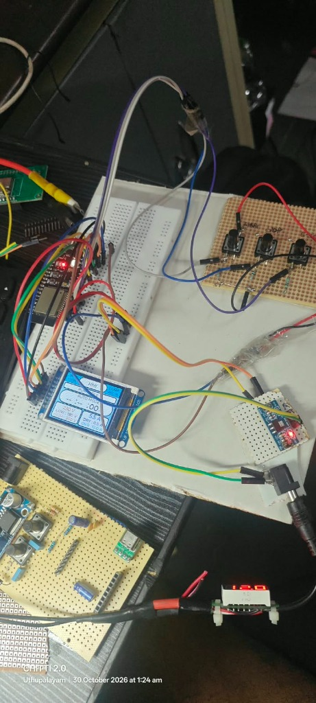
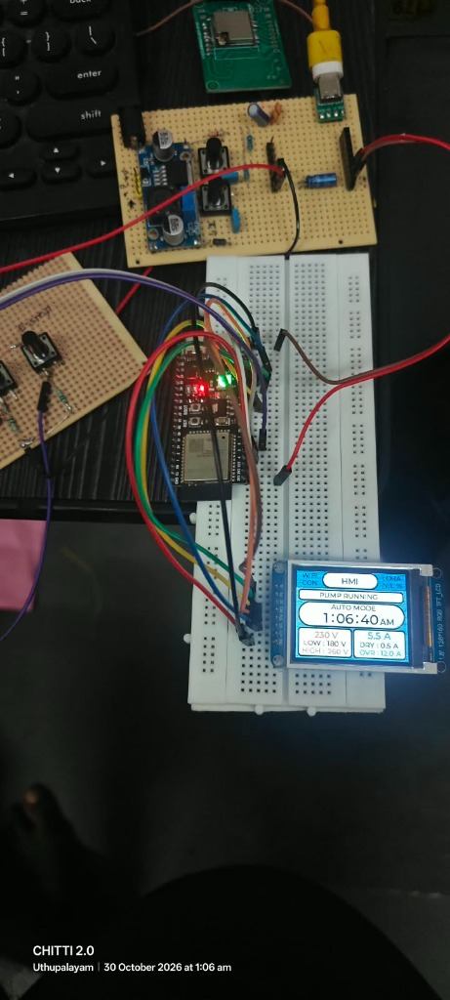
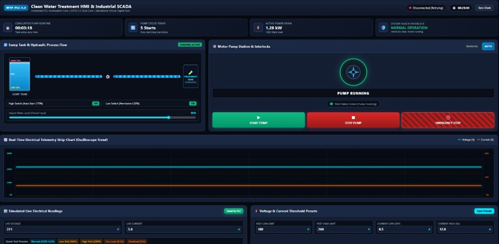

# 🌾 Smart Agri Micro-PLC — Soil Moisture & Precision Irrigation SCADA Automation Platform

**Smart Agri Micro-PLC** is an embedded **Agricultural Automation Micro-PLC & Field SCADA Controller** engineered for smart farming, greenhouse management, and precision drip/sprinkler irrigation systems. Powered by the **ESP32-S3** (240 MHz Dual-Core Xtensa LX7), it combines a dedicated local **1.8" ST7735 TFT display (LVGL v8.3.11)** with an **embedded HTML5 Precision Irrigation SCADA Digital Twin** featuring live soil moisture telemetry, crop root zone monitoring, animated hydraulic distribution, and motor health analytics.

---

## 📸 Real Hardware & SCADA Operation

| Physical Hardware Setup | 1.8" ST7735 Live Display |
|:---:|:---:|
|  |  |
| *Smart Agri Micro-PLC + 3 Industrial Buttons + 1.8" TFT* | *Real-time Display with Soil Status, V/I, Presets & Banners* |

### 🌐 Precision Irrigation Web SCADA Dashboard (Digital Twin)

*Real-time SCADA Web Application served directly from the ESP32-S3 internal web server at `http://192.168.4.1` with crop root bed hydration gradients, drip line flow animations, KPI ribbons, and soil moisture testing sliders.*

---

## 🚀 Key System Features

1. **Human-Centric Soil Irrigation Logic**:
   - **AUTO MODE**: Autonomous irrigation based on root-zone soil moisture:
     - Soil Moisture $\le 30\%$: Auto-starts irrigation pump (`SOIL DRY - IRRIG`).
     - Soil Moisture $\ge 80\%$: Auto-shuts off irrigation pump (`SOIL OPTIMAL - OFF`).
     - Between $30\%$ and $80\%$: Maintains current operational state (anti-chattering hysteresis).
   - **MANUAL MODE**: Unconditional direct operator control (START / STOP) via physical pushbuttons or Web SCADA.

2. **Dedicated Physical Button Interface**:
   - **GPIO 4 (`BTN_START`)**: Irrigation Start button (operational in both Auto & Manual).
   - **GPIO 6 (`BTN_STOP`)**: Irrigation Stop button (operational in both Auto & Manual).
   - **GPIO 5 (`PIN_MODE_BTN`)**: Dedicated Mode toggle button (switches between `AUTO` and `MANUAL`).

3. **Industrial Electrical Supervisor & Motor Protection**:
   - **Overvoltage Protection**: Cutoff when line voltage exceeds 260 V (`IRRIG OFF - HIGH VOLT`).
   - **Undervoltage Protection**: Cutoff when line voltage drops below 180 V (`IRRIG OFF - LOW VOLT`).
   - **Dry Run Protection**: Undercurrent detection below 0.3 A (`IRRIG OFF - DRY LOAD`).
   - **Overload Protection**: Overcurrent detection above 5.0 A (`IRRIG OFF - OVER LOAD`).
   - **Auto-Recovery**: Automatic restart once line parameters return to safe nominal ranges.

4. **1.8" ST7735 TFT Display (LVGL v8.3.11)**:
   - Dedicated `SMART` status badge.
   - Live telemetry: AC Line Voltage (V), Pump Current (A), Soil Moisture (%), Cumulative Run Time.
   - Dynamic real-time status banners.

5. **Integrated Web SCADA (No Internet Required)**:
   - Built-in Wi-Fi SoftAP: `SMART-AGRI-PLC` (Password: `12345678`).
   - Pure HTML5/WebSocket digital twin running on `http://192.168.4.1`.
   - Dual-trace oscilloscope strip-chart and automated irrigation event audit logging.

---

## 🛠️ Hardware Pinout & Architecture

| Component | Pin / GPIO | Function |
|---|---|---|
| **ST7735 TFT CS** | GPIO 10 | SPI Chip Select |
| **ST7735 TFT DC** | GPIO 3 | Data / Command |
| **ST7735 TFT RES** | GPIO 9 | Hardware Reset |
| **ST7735 TFT SCLK** | GPIO 12 | SPI Clock |
| **ST7735 TFT MOSI** | GPIO 11 | SPI Data Out |
| **ST7735 TFT BL** | GPIO 46 | Display Backlight Control |
| **START Button** | GPIO 4 | Active LOW (Internal Pull-Up) |
| **MODE Button** | GPIO 5 | Active LOW (Mode Toggle: AUTO / MANUAL) |
| **STOP Button** | GPIO 6 | Active LOW (Active Stop) |
| **WS2812 RGB LED** | GPIO 48 | Status NeoPixel Indicator |

---

## 📊 Comprehensive Documentation & Technical Reports

Complete project documentation and presentations are available in the repository:
- 📑 [Hardware Pinout & Wiring Specifications](docs/HARDWARE_PINOUT_AND_WIRING.md)
- 📐 [Technical Architecture Report](docs/TECHNICAL_ARCHITECTURE.md)
- 📖 [User & Field Operator Manual](docs/USER_MANUAL.md)
- 📊 [Slide Presentation (PPTX)](docs/WTP_PLC_4.0_Master_Complete_Presentation.pptx)

---

## 🔒 Proprietary Notice
This public repository contains complete technical documentation, architecture blueprints, hardware schematics, and SCADA interface specifications. Proprietary embedded firmware source code (`*.ino`, `*.cpp`) is maintained in an internal release branch.

---

### License
Distributed under the MIT License. See `LICENSE` for more information.
