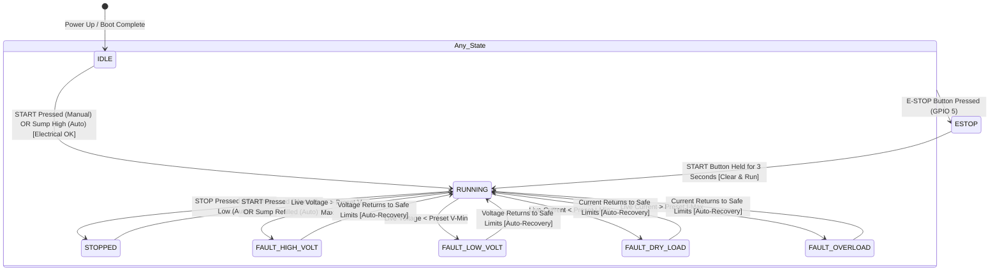

# 💧 Smart Agri Micro-PLC 4.0: Master Technical Architecture & Project Overview Report

**Project Title:** Low-Cost Embedded Industrial PLC & HMI — Clean Water Treatment Automation  
**System Classification:** Micro-PLC with Integrated Local HMI and Web SCADA Digital Twin  
**Processor Core:** Espressif ESP32-S3-WROOM-1U (Dual-Core Xtensa LX7 @ 240 MHz, 16MB Quad-SPI Flash, 8MB Octal-PSRAM)  
**Display:** 1.8-inch ST7735 SPI TFT Color LCD (160×128 Resolution, 16-bit RGB565)  
**Software Framework:** C++ / Arduino on PlatformIO, LVGL v8.3.11 with EEZ-Flow Embedded GUI Engine  
**Release Version:** v4.0.0 (Production Verified on Physical Hardware)  

---

## 1. Executive Summary & Project Purpose

The **Smart Agri Micro-PLC 4.0** was engineered to replace complex, fragile, and high-latency multi-chip IoT architectures (previously relying on LoRa, external cloud databases like Firebase, mobile apps, and auxiliary UART power-metering microcontrollers) with a **high-reliability, standalone embedded PLC + HMI controller**.

Designed specifically for **industrial clean water treatment plants**, the system manages the collection of raw/untreated water from a raw water collection sump tank and pumps it directly into the chemical sterilization and purification stages.

### Core Engineering Requirements Met:
1. **100% Standalone & Autonomous**: Operates entirely without external cloud connections, remote servers, or internet dependency.
2. **Deterministic Dual Modes**:
   - **AUTO MODE**: Autonomous closed-loop pumping based on virtual float switches (Auto-start at high level $\ge 75\%$, cutoff at low level $\le 20\%$).
   - **MANUAL MODE**: Unconditional direct operator override (`START` turns pump ON immediately regardless of sump level; `STOP` turns pump OFF).
3. **Comprehensive Electrical Safety Interlocks**: Real-time evaluation of operating Voltage and Current against user-defined safety thresholds, with instant motor cutoffs:
   - `MOTOR OFF - HIGH VOLT` (Overvoltage cutoff)
   - `MOTOR OFF - LOW  VOLT` (Undervoltage cutoff)
   - `MOTOR OFF - DRY  LOAD` (Dry running / pump cavitation protection)
   - `MOTOR OFF -  OVER LOAD` (Motor mechanical jam / overcurrent cutoff)
4. **Demand-Driven Auto-Recovery Supervisor**: Maintains active pump demand so that whenever an electrical trip occurs, the motor safely cuts off temporarily, and **automatically resumes pumping as soon as electrical parameters recover** to safe limits.
5. **Emergency Stop (E-STOP) with 3-Second Hold Reset**: Instant hardware motor shutdown via GPIO5; reset securely by pressing and holding the physical **START button for $\ge 3$ seconds**.
6. **Local Industrial HMI**: 1.8" ST7735 TFT display running a customized, zero-heap LVGL layout showing real-time IST clock, live and preset V/I telemetry, operating modes, and alarms.
7. **Virtual SCADA Digital Twin**: An embedded web SCADA system served directly from the ESP32-S3's internal flash (`192.168.4.1`) featuring a real-time dual-trace HTML5 Canvas oscilloscope, motor operations audit trail with elapsed run duration, and interactive virtual testing sliders.

---

## 2. Hardware Verification & Live Benchmarks

The entire system has been physically assembled, wired, and verified on breadboard hardware:

| Physical Breadboard Setup | 1.8" ST7735 Live LVGL HMI |
|:---:|:---:|
|  |  |
| *ESP32-S3 PLC + 3 Industrial Buttons + 1.8" TFT* | *Real-time LVGL HMI with Clock, V/I, Presets & Banners* |

### Performance Metrics:
- **Flash Utilization**: 1,396,669 bytes (`33.3%` of 4MB partition).
- **RAM Utilization**: 119,564 bytes (`36.5%` of 320KB internal SRAM).
- **PLC Loop Execution Time**: Sub-1 millisecond response cycle.
- **Display Refresh Rate**: 250ms rate-limited dirty-snapshot update with instantaneous forced state-change refresh.
- **WebSocket Broadcast Latency**: < 5ms to connected web dashboards.

---

## 3. Complete Hardware Pinout & Circuit Schematic

```mermaid
flowchart LR
    subgraph Inputs ["Operator & Virtual Inputs"]
        BTN_S["▶ START Button\n(GPIO 4 + 10kΩ PD)"]
        BTN_ST["⏹ STOP Button\n(GPIO 6 + 10kΩ PD)"]
        BTN_E["🛑 E-STOP Button\n(GPIO 5 + 10kΩ PD)"]
        WS_IN["🌐 Virtual Dashboard\n(V/I & Float Switches)"]
    end

    subgraph Controller ["ESP32-S3 PLC Controller (240MHz)"]
        CORE["PLC Supervisor Logic\n& Protection Interlocks"]
        NVS["NVS Non-Volatile\nThreshold Storage"]
        LVGL_CORE["LVGL v8.3.11\nDisplay Engine"]
        AP_SERVER["WiFi AP & WebSockets\n(Port 80 / 81)"]
    end

    subgraph Outputs ["Plant Actuators & Indicators"]
        RELAY["🔧 Motor Relay Contactor\n(GPIO 7 - Active HIGH)"]
        TFT["📺 1.8\" ST7735 TFT\n(HSPI: GPIO 8, 9, 10, 11, 12, 21)"]
        RGB["💡 WS2812B Smart RGB\n(GPIO 48 Built-in)"]
    end

    BTN_S & BTN_ST & BTN_E --> CORE
    WS_IN <-->|WebSocket :81| AP_SERVER
    AP_SERVER <--> CORE
    CORE <--> NVS
    CORE --> RELAY
    CORE --> RGB
    CORE --> LVGL_CORE
    LVGL_CORE --> TFT
```

### Pin Allocation Table

| Peripheral | Signal | ESP32-S3 Pin | Type | Circuit & Configuration |
|:---|:---|:---:|:---|:---|
| **ST7735 TFT** | `MOSI / SDA` | **GPIO 11** | HSPI Master Out | Hardware SPI Data Line (16 MHz) |
| **ST7735 TFT** | `SCK / SCL` | **GPIO 12** | HSPI Clock | Hardware SPI Clock Line |
| **ST7735 TFT** | `CS` | **GPIO 10** | Output | Chip Select (Active LOW) |
| **ST7735 TFT** | `DC / A0` | **GPIO 9** | Output | Data / Command Select (LOW = Command, HIGH = Data) |
| **ST7735 TFT** | `RESET` | **GPIO 8** | Output | Hardware Reset (Active LOW, pulse on startup) |
| **ST7735 TFT** | `BL (Backlight)`| **GPIO 21** | Output | Backlight Control via BC547 NPN transistor (Active HIGH) |
| **Button 1** | `BTN_START` | **GPIO 4** | Input | Tactile Push Button with **10kΩ external pull-down**.<br>• Short press: Starts pump.<br>• 3s Hold: Clears E-STOP latch & turns pump ON. |
| **Button 2** | `BTN_STOP` | **GPIO 6** | Input | Tactile Push Button with **10kΩ external pull-down**.<br>• Short press: Stops pump.<br>• 2s Hold: Toggles AUTO / MANUAL modes. |
| **Button 3** | `BTN_ESTOP` | **GPIO 5** | Input | Latching Emergency Stop with **10kΩ external pull-down**.<br>• Press: Instant hardware-level motor cutoff, flashes Red RGB. |
| **Motor Relay** | `OUT_MOTOR` | **GPIO 7** | Output | Relay Driver Output (Active HIGH = Pump ON). Drives 5V optocoupled contactor relay. |
| **Built-in RGB**| `RGB_LED` | **GPIO 48** | WS2812B Data | Onboard DevKit NeoPixel. Optical plant status indicator. |

### Built-in RGB Optical Status Codes (GPIO 48)

| System State | Optical Color | RGB Value | Pattern | Description |
|:---|:---:|:---:|:---:|:---|
| **Idle / Standby** | ⚪ White | `(80, 80, 80)` | Steady | System healthy, pump inactive, waiting for demand. |
| **Pump Running** | 🟢 Green | `(0, 180, 0)` | Steady | Motor relay energized, active water pumping. |
| **Pump Stopped** | 🔴 Red | `(180, 0, 0)` | Steady Solid | Pump stopped by operator command or sump empty. |
| **Emergency Stop** | 🔴 Red | `(200, 0, 0)` | **Blinking 500ms** | E-STOP latched. Hardware cutoff locked until reset. |
| **Voltage Cutoff** | 🟡 Yellow | `(180, 130, 0)` | Steady | Overvoltage or undervoltage trip active. |
| **Current Cutoff** | 🟠 Orange | `(180, 60, 0)` | Steady | Overload or dry-run underload trip active. |
| **System Boot** | 🔵 Blue | `(0, 0, 80)` | Steady Fade | Firmware bootloader and splash screen initialization. |

---

## 4. PLC Supervisory State Machine & Logic Architecture

The PLC core operates via a **Demand-Driven Supervisory State Machine** (`wtp_logic.cpp`):



### Safety & Supervisor Algorithms:

#### 1. Electrical Evaluation Function:
```cpp
ElecStatus checkElectrical() {
    // 1. Overvoltage Cutoff
    if (liveVoltage > 0.0f && liveVoltage > presetVoltMax) return ELEC_HIGH_VOLT;
    // 2. Undervoltage Cutoff
    if (liveVoltage > 0.0f && liveVoltage < presetVoltMin) return ELEC_LOW_VOLT;
    // 3. Overload Cutoff
    if (liveCurrent > presetCurrMax) return ELEC_OVERLOAD;
    // 4. Dry Running / Underload Cutoff
    if ((pumpActiveDemand || liveCurrent > 0.0f) && liveCurrent < presetCurrMin) return ELEC_DRY_LOAD;
    
    return ELEC_OK;
}
```

#### 2. Auto-Recovery Execution:
- If a fault occurs while `pumpActiveDemand == true`, the motor relay immediately cuts OFF (`digitalWrite(OUT_MOTOR, LOW)`).
- As soon as the operator corrects the simulated electrical parameters (or edits the presets on the dashboard to encompass the reading), `checkElectrical()` evaluates to `ELEC_OK`.
- The supervisor detects that `pumpActiveDemand == true` and **automatically resumes motor operation without requiring manual button presses**.

---

## 5. LVGL HMI Driver Pipeline & Widget Mapping

The physical 1.8" LCD displays a rich industrial layout designed in EEZ-GUI, updated deterministically without memory fragmentation:

```mermaid
flowchart TD
    PLC["PLC Logic State Machine\n(V, I, Mode, Limits, Status)"]
    VARS["Flow Global Variables\n(vars.h indices 0–13)"]
    EEZ["EEZ Flow Widget Engine\n(screens.c / ui.c)"]
    LVGL["LVGL v8.3.11\nDisplay Core"]
    BUFFER["SRAM Partial Buffer\n(160 × 20 pixels)"]
    SPI["Hardware HSPI Driver\n(16 MHz on GPIO 11/12)"]
    ST7735["1.8\" ST7735 LCD Screen"]

    PLC -->|Rate-Limited Snapshots| VARS
    VARS --> EEZ
    EEZ --> LVGL
    LVGL --> BUFFER
    BUFFER --> SPI
    SPI --> ST7735
```

### Variable Mapping Table

| Variable Index | EEZ Widget Object | Variable Name | Screen Format | Functional Role |
|:---:|:---|:---|:---:|:---|
| **0** | `timer_state_1` | `FLOW_GLOBAL_VARIABLE_MOTOR_STATUS` | Text Banner | Primary status alarm banner (`PUMP RUNNING`, `MOTOR OFF - HIGH VOLT`, etc.) |
| **1** | `timer_hour` | `FLOW_GLOBAL_VARIABLE_TIME_HOUR` | `01` to `12` | 12-hour calibrated Montserrat 20 digit |
| **2** | `timer_min` | `FLOW_GLOBAL_VARIABLE_TIME_MIN` | `00` to `59` | 2-digit minute display |
| **3** | `timer_apm` | `FLOW_GLOBAL_VARIABLE_TIMER_APM` | `AM` / `PM` | Meridian indicator |
| **4** | `timer_state` | `FLOW_GLOBAL_VARIABLE_TIMER_STATE` | `AUTO MODE` / `MANUAL` | Mode sub-label |
| **5** | `voltage_ac` | `FLOW_GLOBAL_VARIABLE_VOLTAGE_AC` | `230 V` | Live AC Voltage (3-digit integer) |
| **6** | `current_ac` | `FLOW_GLOBAL_VARIABLE_CURRENT_AC` | `5.5 A` | Live AC Current (1 decimal digit) |
| **10** | `voltage_low_ac_` | `FLOW_GLOBAL_VARIABLE_VOLTAGE_LOW_AC` | `180 V` | Preset Undervoltage threshold |
| **11** | `voltage_high_ac` | `FLOW_GLOBAL_VARIABLE_VOLTAGE_HIGH_AC` | `260 V` | Preset Overvoltage threshold |
| **12** | `current_ac_low` | `FLOW_GLOBAL_VARIABLE_CURRENT_AC_LOW` | `0.5 A` | Preset Dry Run threshold |
| **13** | `current_ac_high`| `FLOW_GLOBAL_VARIABLE_CURRENT_AC_HIGH`| `12.0 A` | Preset Overload threshold |

---

## 6. Industrial SCADA 4.0 Digital Twin (Web Application)

Served directly from the ESP32-S3's internal flash (`http://192.168.4.1`), the SCADA dashboard delivers a level of industrial monitoring typically found on enterprise PLCs:

| SCADA Dashboard Full View | Telemetry Oscilloscope & Audit Log |
|:---:|:---:|
|  |  |

### Key SCADA Features:
1. **Real-Time Rolling Oscilloscope Strip-Chart**:
   - Zero-dependency, pure HTML5 Canvas running at 60 FPS offline.
   - Dual-trace monitoring: Neon Cyan (`#00e5ff`) for Voltage and Amber (`#f97316`) for Current.
   - Dynamic dashed limit reference lines matching preset trip points.
2. **Motor Operations Audit Trail & Timestamp Log**:
   - Captures every operational transition (`MOTOR START`, `MOTOR STOP`, `FAULT CUTOFF`, `AUTO RECOVERY`, `E-STOP`).
   - Computes **exact elapsed run durations** for every completed pumping cycle (e.g., `Ran for 48s`).
3. **KPI Metrics Ribbon**:
   - Cumulative Pump Runtime (`HH:MM:SS`) with live 1-second auto-increment.
   - Starts / Cycle counter.
   - Active load power calculation ($P = V \times I$ in kW and Watts).
   - System health interlock diagnostics.
4. **Hydraulic Process Flow (P&ID Schematic)**:
   - Animated water surface with high (75%) and low (20%) limit switch lamps.
   - Animated pipe flow waves moving through the suction and discharge pipes when pumping is active.
5. **Authentic 1.8" TFT Physical Mirror**:
   - Industrial enclosure casing with corner hex bolts and LCD screen contrast matching the hardware display.

---

## 7. Firmware Architecture & Source Code Organization

```text
WTP_PLC/
├── docs/
│   ├── images/
│   │   ├── hardware_setup.jpg            # Physical breadboard setup photo
│   │   ├── hmi_display_live.jpg          # ST7735 LCD live screen close-up
│   │   ├── scada_dashboard_full.jpg      # Web SCADA widescreen view
│   │   └── scada_dashboard_telemetry.jpg # SCADA trend chart & audit log
│   ├── HARDWARE_AND_LVGL_DRIVERS.md      # In-depth pinout & LVGL architecture guide
│   └── PROJECT_OVERVIEW_AND_TECHNICAL_ARCHITECTURE.md # Master Technical Report
├── WTP_MASTER/
│   ├── data/
│   │   └── index.html                    # Industrial SCADA single-page app
│   ├── WTP_MASTER.ino                    # Setup, LVGL prime loop & task scheduler
│   ├── config.h                          # Network AP credentials, IST timezone & defaults
│   ├── pins.h                            # Pin definitions
│   ├── buttons.h / buttons.cpp           # Debounced button state machine & long-hold logic
│   ├── display_mgr.h / display_mgr.cpp   # ST7735 driver, LVGL updater & C-getters
│   ├── rgb_led.h / rgb_led.cpp           # WS2812B NeoPixel driver
│   ├── wtp_logic.h / wtp_logic.cpp       # PLC state machine, electrical supervisor & NVS
│   ├── web_server.h / web_server.cpp     # WebServer (port 80) & WebSockets (port 81)
│   ├── platformio.ini                    # PlatformIO build configuration
│   └── (EEZ GUI files: ui.c, screens.c, vars.h, eez-flow.cpp)
├── log/                                  # Development audit logs
├── implementation_plan.md                # Project roadmap
├── LICENSE                               # MIT License
└── README.md                             # Top-level GitHub presentation document
```

---

## 8. Summary & GitHub Readiness

The **Smart Agri Micro-PLC 4.0** firmware is production-ready, fully verified on physical hardware, and cleanly structured as an independent Git repository ready for publishing via GitHub Desktop or the command line. All legacy SaveOn dependencies have been completely eliminated.
