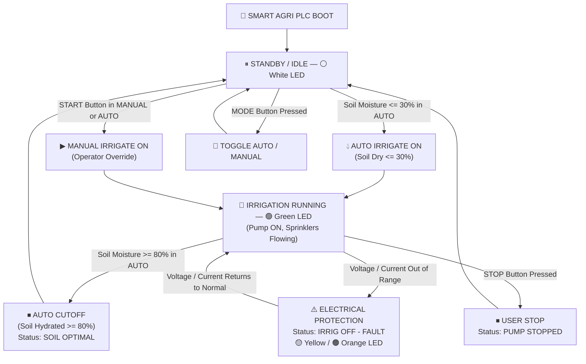

# 🌾 Smart Agriculture — Soil Moisture & Irrigation Micro PLC Implementation Plan

**Project:** Smart Agriculture Soil Moisture Irrigation Management System & Industrial SCADA Digital Twin  
**Controller:** Espressif ESP32-S3 (240 MHz, 16MB Flash, 8MB PSRAM) + 1.8" ST7735 TFT (160×128)  
**Version:** v1.1 — Clean Agri Architecture (Zero Emergency Stop)  
**Status:** 🟡 AWAITING FEEDBACK / READY TO EXECUTE  

---

## 1. Goal Description & Domain Transformation

Transform the existing Water Treatment Plant (WTP) PLC into a human-centric **Smart Agriculture Soil Moisture Irrigation Micro-PLC & SCADA**:
1. **Soil Moisture Control Logic**:
   - The former "sump tank" is transformed into an **Agricultural Soil Bed / Soil Moisture System** ($0\% - 100\%$).
   - **AUTO MODE**:
     - When Soil Moisture $\le 30\%$ (**DRY SOIL**): Automatically activates the irrigation pump.
     - When Soil Moisture reaches $\ge 80\%$ (**OPTIMAL / WET SOIL**): Automatically stops the irrigation pump to prevent waterlogging.
   - **MANUAL MODE**:
     - Unconditional operator irrigation control: `START` turns irrigation ON; `STOP` turns irrigation OFF, regardless of soil moisture.
2. **Dedicated Physical Buttons (GPIO 4, 5, 6) & ZERO Emergency Stop**:
   - **GPIO 4 (`BTN_START`)**: Irrigation Pump **START** (Active in both Auto and Manual).
   - **GPIO 6 (`BTN_STOP`)**: Irrigation Pump **STOP** (Active in both Auto and Manual).
   - **GPIO 5 (`BTN_MODE`)**: **Dedicated MODE Button** (Short tap or 1-second press smoothly toggles between `AUTO` and `MANUAL` modes).
   - **Zero Emergency Stop**: Completely removed from physical buttons, firmware logic, and the web SCADA dashboard.
3. **Local 1.8" ST7735 TFT HMI Display**:
   - Replaced `"HMI"` mode info banner with `"SMART"` (`SMART AGRI`).
   - Sump label indicators converted to Agri indicators (`SOIL: DRY`, `SOIL: WET`, or field connection status).
   - Status banner: `"IRRIGATION ACTIVE"`, `"SOIL OPTIMAL - OFF"`, `"SOIL DRY - IRRIG"`, `"IRRIG OFF - HIGH VOLT"`, `"IRRIG OFF - DRY LOAD"`, etc.
4. **SCADA 4.0 Agricultural Digital Twin (`http://192.168.4.1`)**:
   - **Clean Control Panel**: START PUMP and STOP PUMP buttons only (E-STOP button completely eliminated).
   - Transformed the Water Tank simulation into a **Soil Bed Cross-Section & Root Zone**:
     - Color-coded moisture strata (Dry Amber $\rightarrow$ Healthy Green $\rightarrow$ Hydrated Blue).
     - Interactive Soil Moisture Slider ($0\% - 100\%$).
     - Irrigation Pipe & Field Sprinklers / Drip Lines animation (water flowing into soil when pump is ON).
   - Real-time Canvas oscilloscope monitoring motor voltage and pump current.
   - Comprehensive Motor & Irrigation Event Audit Log with timestamps and irrigation durations.

---

## 2. Hardware BOM & Pin Mapping

| Component | Pin / Signal | ESP32-S3 GPIO | Description |
|:---|:---|:---:|:---|
| **START Button** | `BTN_START` | **GPIO 4** | Physical Start Push Button (10kΩ pull-down). Instant pump ON. |
| **STOP Button** | `BTN_STOP` | **GPIO 6** | Physical Stop Push Button (10kΩ pull-down). Instant pump OFF. |
| **MODE Button** | `PIN_MODE_BTN` | **GPIO 5** | Dedicated Physical Mode Toggle (10kΩ pull-down). Switches `AUTO` $\leftrightarrow$ `MANUAL`. |
| **Irrigation Relay** | `OUT_MOTOR` | **GPIO 7** | 5V Relay driver (Active HIGH = Irrigation Pump ON). |
| **RGB Smart LED** | `PIN_RGB_LED` | **GPIO 48** | Onboard WS2812B NeoPixel indicator. |
| **1.8" ST7735 TFT** | `MOSI, SCK, CS, DC, RST, BL` | **GPIO 11, 12, 10, 9, 8, 21** | 16 MHz HSPI LVGL Graphic HMI. |
| **Soil Moisture Sensor** | Virtual / Simulated | Dashboard Slider | Virtual soil moisture slider ($0\% - 100\%$). |

---

## 3. Soil Irrigation Supervisory State Machine

---

## 4. Step-by-Step Execution Plan

### Step 1: Update Hardware Pinout & Button Logic (`pins.h`, `buttons.h`, `buttons.cpp`, `WTP_MASTER.ino`)
- Reconfigure GPIO 5 as `PIN_MODE_BTN`.
- Set up `handleButton` for GPIO 5 to toggle between `AUTO` and `MANUAL` modes.
- Remove all Emergency Stop variables, latching flags, and recovery timers from firmware.
- Update `WTP_MASTER.ino` loop to process `btnMode.confirmedShort` for mode toggle, while keeping `BTN_START` (GPIO 4) and `BTN_STOP` (GPIO 6) clean and highly responsive.

### Step 2: Update Core Irrigation & Soil Logic (`wtp_logic.h`, `wtp_logic.cpp`, `config.h`)
- Refactor logic to evaluate Soil Moisture level ($0 - 100\%$):
  - In `MODE_AUTO`: If `soilMoisture <= 30%` $\rightarrow$ trigger irrigation `pumpActiveDemand = true`. If `soilMoisture >= 80%` $\rightarrow$ stop irrigation `pumpActiveDemand = false`, set state `WTP_SOIL_OPTIMAL`.
  - In `MODE_MANUAL`: Operator `START` immediately forces `pumpActiveDemand = true`, `STOP` cancels demand.
- Keep electrical protection (`HIGH VOLT`, `LOW VOLT`, `DRY LOAD`, `OVERLOAD`) with automatic recovery.

### Step 3: Update LVGL Display & Variable Text (`display_mgr.h`, `display_mgr.cpp`, `vars.h`)
- Change `FLOW_GLOBAL_VARIABLE_MODE` from `"     HMI"` to `"   SMART"` (and C-getter `getModeInfoDisplayText()` $\rightarrow$ `"   SMART"`).
- Update banners to Agri-focused strings:
  - `"     IRRIGATION ACTIVE"`
  - `"     IRRIGATION STOPPED"`
  - `"      SOIL OPTIMAL - OFF"`
  - `"      SOIL DRY - IRRIG"`
  - `" IRRIG OFF - HIGH VOLT"`
  - `" IRRIG OFF - LOW  VOLT"`
  - `" IRRIG OFF - DRY  LOAD"`
  - `" IRRIG OFF - OVER LOAD"`

### Step 4: Overhaul Web SCADA 4.0 Dashboard (`data/index.html` & `web_server.cpp`)
- Rebrand UI header to: **Smart Agriculture — Soil Moisture Irrigation SCADA**.
- Completely eliminate Emergency Stop button, E-STOP indicator banner, and reset prompt.
- Convert Sump Tank into **Soil Bed & Agricultural Field**:
  - Show Soil Moisture percentage, moisture status badges (`DRY: <=30%`, `HEALTHY: 31-79%`, `OPTIMAL/WET: >=80%`).
  - Update schematic: Water source $\rightarrow$ Irrigation Pump $\rightarrow$ Drip Irrigation / Sprinkler lines over agricultural crops.
- Update telemetry and KPI ribbons (Cumulative Irrigation Time, Irrigation Starts Today, Power Draw).

### Step 5: Build, Verify Compilation & Upload [COMPLETED]
- [x] Compile via PlatformIO (`pio run -d WTP_MASTER`) — Successful (RAM 36.5%, Flash 33.2%).
- [x] Flash firmware to ESP32-S3 over COM17 (`pio run --target upload --upload-port COM17`) — Successful (Wrote 1,394,848 bytes, verified).
- [x] Record change logs and test status.
